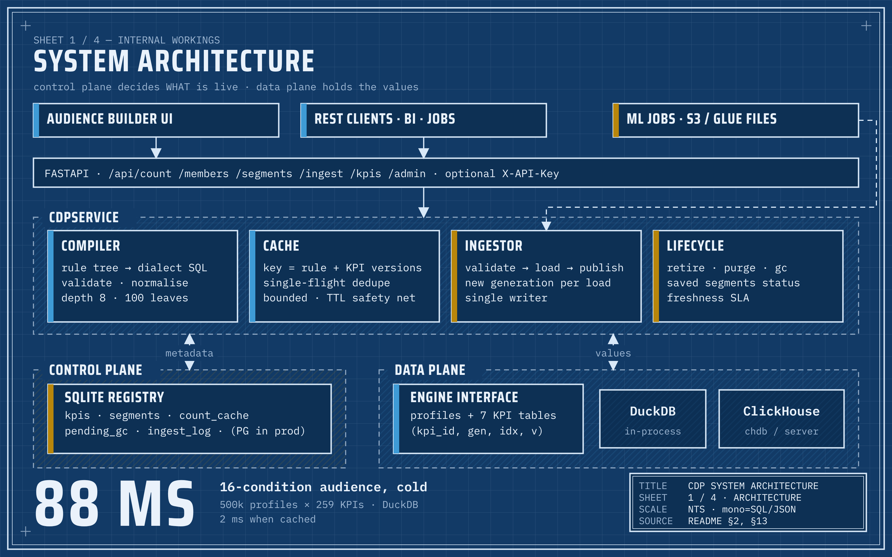
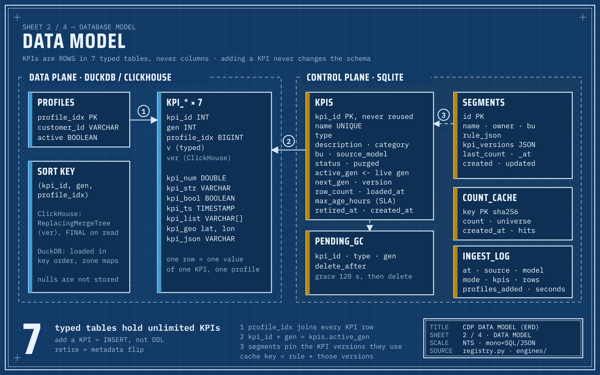
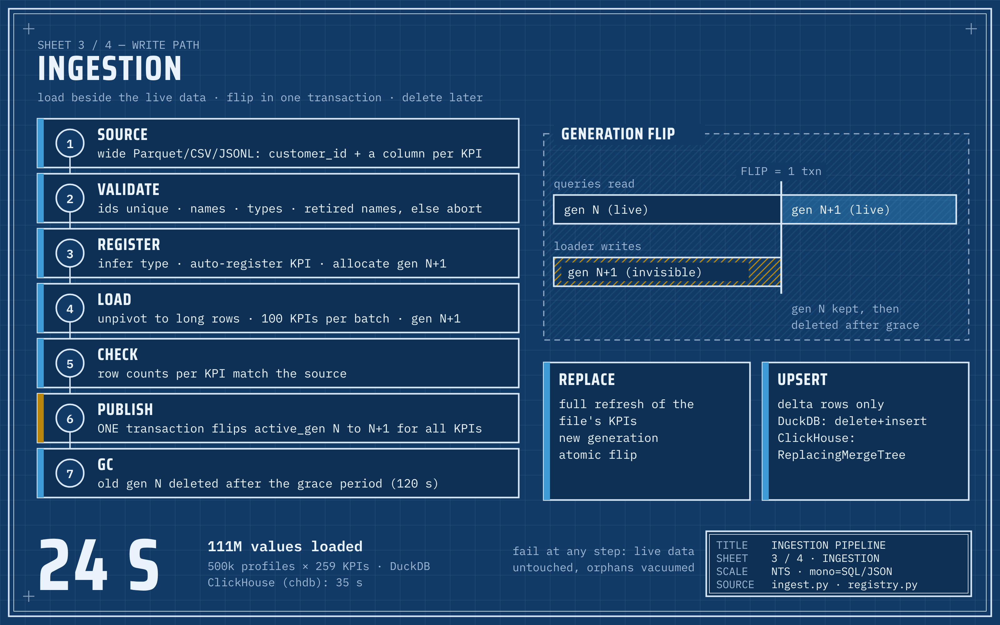
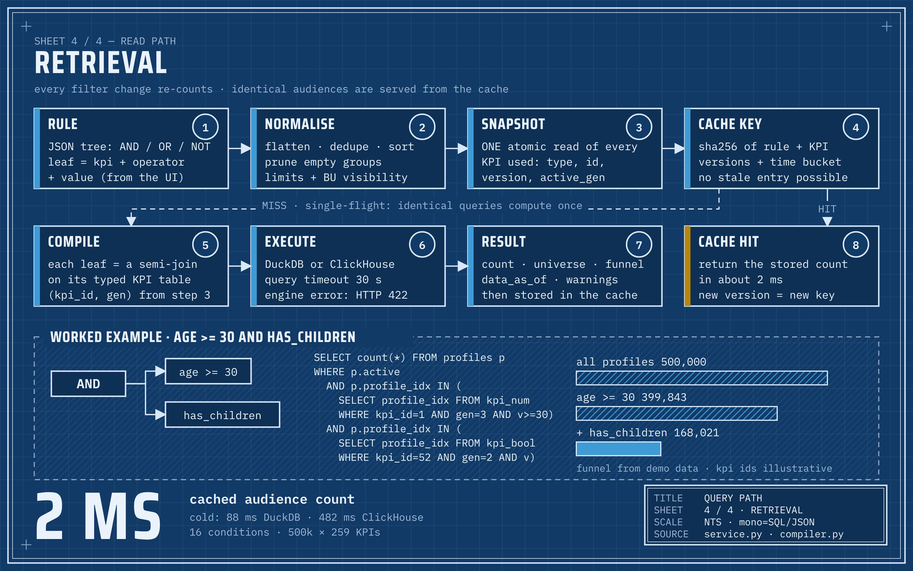

# CDP Platform: self-managed audience engine

A Customer Data Platform core for a SaaS product: ML models keep adding KPIs, campaign managers
build audiences from 15+ filters with live counts, and KPIs can be retired at scale.
Python, open source, no licence cost. It runs on **DuckDB** or **ClickHouse** behind one interface.

- 460 automated tests, both engines checked against an independent Python oracle
- 500k profiles × 259 KPIs (111M values): 16-condition query in **88 ms cold / 2 ms cached** (DuckDB)
- Retire 200 KPIs in **3 ms**, physically purge in 0.3 s

---

## 1. Quick start

```bash
pip install -r requirements.txt
python -m cdp.cli --data-dir ./data demo --profiles 20000      # sample org: 5 BUs, 59 KPIs
CDP_DATA_DIR=./data python -m uvicorn --factory cdp.api:create_app --port 8000
# open http://localhost:8000   (UI)    /docs   (API)
```

| Task | Command |
|---|---|
| ClickHouse engine (embedded chdb) | add `--engine clickhouse` / `CDP_ENGINE=clickhouse` |
| Add 200 ML KPIs to the demo | `demo --profiles 20000 --ml-kpis 200` |
| Ingest your own file | `ingest file.parquet --model my_model --mode replace` |
| Count from a rule file | `count rule.json` |
| Retire / purge / freshness | `retire`, `purge`, `freshness`, `stats`, `refresh-segments` |
| Benchmark | `bench --runs 5` |
| Tests | `python -m pytest -q` |

**UI** (single file, no build step): *Audience builder* (nested AND/OR/NOT groups, an operator and value
editor per datatype, live count after every change, funnel showing how many each filter removes, sample
members, profile inspector, **total-vs-audience charts** (donut of audience share, funnel bars, and a *Split by* breakdown of any text / yes-no / list / number KPI as bars or paired pies), a responsive mobile layout (bottom result bar, filter sheet), **type-ahead value suggestions** (type `new` and pick from matching cities; works for string and list KPIs, multi-select chips for `in` / `contains any`), save/load segments with ok/stale/broken badges) and *Data & KPIs* (upload new
data, KPI table, retire a KPI or a whole model, purge, refresh stale segments, freshness list).

---

## 2. Architecture



**Control plane vs data plane.** *What a KPI is* (name, type, owner BU, freshness SLA, which generation is
live) lives in a small transactional store. *The values* live in the analytical engine. Publishing is a
single control-plane transaction, which is what makes refreshes atomic.

---

## 3. Design and justification

### 3.1 Why not a snowflake schema with dimension tables and a mapping table
The idea was: filter dimension tables, then use the resolved IDs against a mapping table and the customer fact.

- **Every new KPI changes schema.** With ML adding KPIs continuously, "unlimited KPIs" means unlimited
  DDL, columns or dimension tables. Wide tables hit column limits (Parquet/Glue/most engines), and
  1000+ columns make every file read and every catalog operation heavy.
- **Dimensions do not fit KPIs.** A dimension is a small set of *values* (city, tier). A KPI like
  `ml_churn_score` is a continuous number per customer; there is nothing to normalise into a dimension.
  It would become a mapping row per customer per value, which is just the long table below, with an extra join.
- **The mapping table becomes the bottleneck.** Every query ends in one giant join at 50M × KPIs.
- **Deleting a KPI means altering the fact table**; here it is metadata plus a deferred delete.

### 3.2 Chosen model: typed long (EAV) tables, one per datatype
`(kpi_id, gen, profile_idx, value)` sorted by `(kpi_id, gen, profile_idx)`.

- **Adding a KPI is an insert, never DDL.** 1 KPI or 10,000 use the same 7 tables.
- **A query reads only the KPIs it uses.** Sorting by `kpi_id` means one KPI's values are contiguous, so
  reading 16 of 259 KPIs scans ~6% of the data. Columnar compression is strong on a single typed column.
- **Typed tables give correct filters per datatype** (numbers compare as numbers, timestamps as timestamps,
  lists, geo and JSON have their own operators) without casting.
- **Nulls are not stored** (absence = null), so sparse KPIs cost nothing.
- **Trade-off, stated honestly:** this is optimised for "which profiles match" (audiences) and counts. A
  full-profile read ("all 1000 KPIs of one customer") touches many sorted ranges. That is fine for the profile
  inspector, not for bulk exports of wide rows. For that, export via the engine directly.
- **Integer `profile_idx`** (dense surrogate for `customer_id`) keeps every KPI table narrow and makes
  set operations cheap.

### 3.2a Database model



**Data plane** (DuckDB or ClickHouse). DuckDB DDL shown; ClickHouse uses the same columns plus `ver`,
`ENGINE = ReplacingMergeTree(ver) ORDER BY (kpi_id, gen, profile_idx)`.

```sql
profiles(profile_idx BIGINT, customer_id VARCHAR, active BOOLEAN)
kpi_num (kpi_id INT, gen INT, profile_idx BIGINT, v DOUBLE)
kpi_str (kpi_id INT, gen INT, profile_idx BIGINT, v VARCHAR)
kpi_bool(kpi_id INT, gen INT, profile_idx BIGINT, v BOOLEAN)
kpi_ts  (kpi_id INT, gen INT, profile_idx BIGINT, v TIMESTAMP)
kpi_list(kpi_id INT, gen INT, profile_idx BIGINT, v VARCHAR[])
kpi_geo (kpi_id INT, gen INT, profile_idx BIGINT, lat DOUBLE, lon DOUBLE)
kpi_json(kpi_id INT, gen INT, profile_idx BIGINT, v VARCHAR)
```

**Control plane** (SQLite now, Postgres in production):

| Table | Purpose | Key columns |
|---|---|---|
| `kpis` | One row per KPI; decides what is live | `kpi_id` (autoincrement, never reused), `name` UNIQUE, `type`, `bu`, `source_model`, `status`, **`active_gen`**, `next_gen`, `version`, `max_age_hours`, `loaded_at`, `retired_at`, `purged` |
| `segments` | Saved filter combinations | `rule_json`, `kpi_versions` (the versions the last count used), `last_count` |
| `count_cache` | Cached audience counts | `key` = sha256(rule + KPI versions + time bucket), `count`, `universe`, `hits` |
| `pending_gc` | Superseded generations waiting to be deleted | `(kpi_id, gen)`, `delete_after` |
| `ingest_log` | Audit of loads | `source`, `model`, `mode`, `kpis`, `rows`, `seconds` |

**How they relate.** `profile_idx` joins every KPI row to its customer; `kpi_id` + `gen` select the live values
(`gen` = `kpis.active_gen`); a segment stores the KPI versions it was counted with, so a later refresh marks it
stale; the cache key includes the same versions, so a refresh makes old entries unreachable.

### 3.3 Query shape
Each leaf becomes a semi-join; groups combine them:

```sql
p.profile_idx IN (SELECT profile_idx FROM kpi_num WHERE kpi_id=12 AND gen=3 AND value > 0.5)
AND ( p.profile_idx IN (...) OR NOT p.profile_idx IN (...) )
```
`kpi_id` and `gen` are resolved from the registry at compile time, so the engine prunes by the sort key.

### 3.4 Generation-based atomic publish (how refreshes stay consistent)
A load writes new rows under a **new `gen`** while queries keep reading the old one. When every KPI from
the file is loaded and counted, **one SQLite transaction flips `active_gen` for all of them** (`publish_many`).
- Readers never see half-loaded data, and never see KPI A new and KPI B old from the same file
  (the compiler takes one atomic snapshot of all KPIs a rule uses; see the concurrency test).
- A failed load leaves live data untouched; orphan generations are cleaned up.
- Superseded generations are deleted only after a **grace period** (`CDP_GC_GRACE_S`, default 120 s), so a
  query that resolved the old generation a moment before the flip still finds intact data.
- `kpi_id` is AUTOINCREMENT and **never reused**, so an old saved segment can never silently bind to a
  different KPI that took over a name. Retired names cannot be re-ingested; ship the new model version
  under new names (e.g. `churn_v4_*`).

---

## 4. Ingestion



Source: a **wide** Parquet / CSV / JSONL file (local `<data_dir>/inbox`, `s3://`, `https://`, or upload) with a
`customer_id` column plus one column per KPI. Staying wide at the *file* level is fine; the platform
converts to long.

1. Validate everything first (id uniqueness, KPI name format, type conflicts, retired names). Nothing is
   touched if validation fails.
2. Types are inferred from the source (numbers, strings, bools, timestamps, lists, `STRUCT`/JSON, and
   `{lat, lon}` geo structs) and KPIs are auto-registered. Metadata (category, BU, description,
   freshness SLA) can be supplied.
3. Batched long-format staging (100 KPIs per batch) is loaded into the typed tables under a new generation.
4. Row counts are checked, then `publish_many` flips the generation. Old generations are scheduled for GC.

| Mode | Behaviour |
|---|---|
| `replace` | Full refresh of the file's KPIs; new generation; atomic. |
| `upsert` | Delta: only the supplied profiles change. DuckDB deletes+inserts in one transaction; ClickHouse uses `ReplacingMergeTree(ver)` read with `FINAL`. |

Measured: 500k profiles, 259 KPIs, 111M values loaded in **~24 s (DuckDB)** and **~35 s (ClickHouse, chdb)** on a 2-vCPU box.

---

## 5. Querying



A rule is JSON: groups `AND` / `OR` / `NOT` containing leaves `{kpi, operator, value}`, nestable to depth 8,
up to 100 leaves. The rule is validated, **normalised** (flatten, dedupe, sort, prune empty groups) so equal
audiences share a cache key, then compiled per dialect.

| Type | Operators |
|---|---|
| number | eq ne gt gte lt lte between in not_in |
| string | eq ne in not_in contains not_contains starts_with ends_with regex (contains/starts/ends are case-insensitive) |
| bool | is_true is_false |
| datetime | on_date before after between within_last not_within_last |
| list | contains not_contains contains_any contains_all size_* is_empty first_is |
| geo | within_radius (bbox prefilter + haversine) outside_radius within_bbox |
| json | json_eq ne gt gte lt lte contains, using a dotted path (`drivers.price`) |
| all | is_null is_not_null |

**Semantics to know.** Negative operators (`ne`, `not_in`, `not_contains`, …) match only profiles that *have* a
value. To include profiles with no value, wrap in a `NOT` group. Relative-time filters (`within_last 30 day`)
are rounded to their unit so the SQL and the cache key agree.

**Safety.** All literals are escaped per dialect, JSON paths are whitelisted, regex is capped at 200 chars and
uses RE2 in both engines (no catastrophic backtracking), and engine errors become HTTP 4xx, never 500.
A BU selector hides other BUs' KPIs; referencing one returns 422.

**Funnel.** `explain=true` returns the count after each condition in the user's order, so a campaign
manager sees which filter removes the most people.

---

## 6. Caching

- **Key** = sha256 of (normalised rule, `(kpi_id, version, active_gen)` of every KPI used, relative-time bucket).
- **Invalidation is by construction.** A refresh bumps a KPI's version/generation, so exactly the queries
  that used it get a new key. Nothing else is evicted, and no stale entry can be served. TTL (6 h default) is
  only a safety net.
- **Single-flight.** Identical concurrent queries compute once; the rest wait for the result.
- **Funnel prefixes are cached**, so re-opening an earlier step in the experiment loop is instant.
- Bounded size (`CDP_CACHE_MAX`). Stored in SQLite; use Redis if you run several app instances.

---

## 7. Refreshing and fixing stale data

| Problem | Mechanism |
|---|---|
| Cached count after a refresh | Version-stamped keys (cannot be served; tested) |
| Saved segment's count is old | Status `ok` / `stale` / `broken`; `POST /api/segments/refresh-stale` recounts only stale ones |
| Segment uses a retired KPI | Status `broken` (shown in UI), never silently wrong |
| ML job did not run | Per-KPI `max_age_hours` SLA → warning in each count result, `data_as_of` timestamp, `/api/admin/freshness` report |
| Half-refreshed data | Atomic generation flip; concurrent-refresh stress test asserts no torn reads |
| Wrong data loaded | Re-ingest with `replace` (new generation, atomic); old generation kept for the grace period |

---

## 8. KPI lifecycle at scale

- **Retire** (by KPI or by `source_model`): metadata flip, instant (200 KPIs in 3 ms). Queries stop seeing it at once; segments using it become `broken`.
- **Purge:** physical delete of retired KPIs' rows, run off-peak (200 KPIs in 0.3 s on DuckDB; a ClickHouse
  `ALTER … DELETE` mutation is heavier, so schedule it).
- **GC** of superseded generations happens before every ingest and via `svc.gc()`.
- ML adds KPIs by shipping a file; nothing else to deploy.

---

## 9. DuckDB or ClickHouse

| | DuckDB | ClickHouse |
|---|---|---|
| Deployment | In-process, zero ops | Embedded (chdb) for dev/CI; server/cluster for production |
| Cold 16-condition query (500k × 259) | 88 ms | 482 ms (embedded, 2 vCPU, `FINAL`) |
| Ingest 111M values | ~24 s | ~35 s |
| Scale-out | One node (vertical) | Sharding/replication, S3-backed storage |
| Concurrency | Single process, many readers | Built for many concurrent queries |
| Upsert | Delete + insert in a transaction | ReplacingMergeTree + `FINAL` |
| Use when | Up to tens of millions of profiles on one big box, lowest cost and effort | Many concurrent users, growth beyond one node, HA |

Both engines produce **identical counts and funnels** on the same data (verified in tests and benchmark: 278 = 278).
Recommendation: start on DuckDB, keep the interface, move to ClickHouse when concurrency or size demands it.

---

## 10. Scenarios (all covered by `tests/test_scenarios.py`)

Sample organisation: a group with 5 BUs (Retail, Fashion, Grocery, Finance, Travel).

1. **Campaign manager, Travel BU, 16 filters** across numbers, strings, bools, timestamps, lists, geo radius, JSON path and nested OR/NOT. Count equals the oracle; the funnel is non-increasing.
2. **Experiment loop:** add filters one by one, counts fall monotonically, re-open a step and hit the cache.
3. **Save and reuse** segments per owner and BU.
4. **Nightly ML refresh:** churn scores reload → saved segment turns `stale` → cache cannot serve the old count → refresh recounts it → `ok`.
5. **New ML model with 200 KPIs**, then retire the whole model and purge; rest of the CDP untouched; re-ingest under the old names is refused, a versioned name works.
6. **Location:** radius counts around Dubai, Abu Dhabi, London match the oracle.
7. **Family analytics:** nested has-children / age bands / marital status / spend share.
8. **BU isolation:** each BU sees only its own spend/ML KPIs plus `ALL`.

---

## 11. API

`POST /api/breakdown` (`{rule, kpi, limit}` → per value / numeric bin: audience vs total counts, plus "other" and "no value"; version-stamped cache) · `GET /api/kpis/{name}/values?q=` (type-ahead for string/list KPIs: matches case-insensitively, prefix matches first, with counts; cached per KPI generation) ·
`GET /api/health | meta | kpis | stats | admin/freshness | profile/{id}` ·
`POST /api/count | members` ·
`/api/segments` (CRUD) `+ /{id}/refresh`, `/refresh-stale` ·
`POST /api/ingest` (raw upload) `| ingest/path | ingest/json` ·
`POST /api/kpis/{name}/retire | models/{model}/retire | admin/purge | admin/cache/clear | admin/demo`.
Set `CDP_API_KEY` to require an `X-API-Key` header. `/api/ingest/path` only reads `<data_dir>/inbox`, `s3://` or `https://`.

Config (env): `CDP_DATA_DIR`, `CDP_ENGINE`, `CDP_CLICKHOUSE_URL`, `CDP_CACHE_TTL_S`, `CDP_CACHE_MAX`,
`CDP_QUERY_TIMEOUT_S`, `CDP_MAX_UPLOAD_MB`, `CDP_GC_GRACE_S`, `CDP_API_KEY`.

---

## 12. Testing

`python -m pytest -q` → 460 tests, ~30 s.
- **Operator matrix vs oracle** (243): every operator on every datatype, DuckDB, ClickHouse and an independent pure-Python evaluator must agree.
- **Compiler** (72): normalisation, limits, injection attempts, escaping, BU visibility.
- **Ingest and lifecycle** (53): replace/upsert, atomic flip, failure cleanup, retire/purge, grace period.
- **Cache and staleness** (30), **concurrency** (readers during 30 refreshes never see a mixed state; found and fixed two real thread-safety bugs and one torn-read bug).
- **API** (40) and **scenarios** (20).

---

## 13. Scaling to 50M profiles / 1000+ KPIs (estimate, not measured)

Measured on 2 vCPU / 7 GB: 500k × 259. Extrapolating **linearly** (a query scans only the KPIs it
touches): a 16-condition audience at 50M profiles is roughly 100× the rows, so **single-digit seconds** on
a 2-core DuckDB box, lower with more cores or a ClickHouse cluster. Storage was ~2 bytes/value on DuckDB, so
50M × 1000 KPIs at similar density is on the order of **100 GB** (compressed). Treat both as planning
numbers; run `bench` on production-sized data on your target hardware before committing.
The count cache, funnel prefixes and 250 ms UI debounce keep interactive use responsive even when a cold
query takes seconds.

---

## 14. Assumptions

- One row per customer per file; `customer_id` is a stable string key.
- Audience counts need to be *correct and fresh*, not sub-second at cold start.
- ML produces KPI files on a schedule (batch), not a stream.
- Source of truth for raw data is S3/Glue; this platform holds the *serving* copy. Data stays in the UAE region (residency).
- A KPI belongs to one datatype for life; a type change means a new KPI name.
- Users are authenticated upstream (gateway/SSO); the platform trusts the BU the caller sets.

## 15. Risks and mitigations

| Risk | Mitigation |
|---|---|
| Single-writer ingest | Writes are serialised; schedule loads; one ingest per model file |
| Cache in SQLite does not span instances | Move cache to Redis before running >1 app instance |
| Control plane is SQLite | Swap for Postgres in production (same SQL; backups; HA) |
| ClickHouse `FINAL` cost on large upsert tables | Prefer `replace` loads; run `OPTIMIZE` off-peak |
| ClickHouse join memory on 50M `profiles` | Use a ClickHouse dictionary or keep `profile_idx` filters on the KPI side |
| PII | Audience counts return no identities; `members`/`profile` do. Restrict by role and log access |
| Slow/abusive queries | Depth/leaf/IN-list limits, query timeout, regex cap |
| Silent ML failure | Freshness SLA warnings in every count |

## 16. Dependencies

Python 3.10+, `duckdb`, `fastapi`, `uvicorn`, `pydantic`, `pyarrow`, `chdb` (embedded ClickHouse),
`clickhouse-connect` (server mode); tests: `pytest`, `httpx`. All open source; no licence fees.
SQLite ships with Python.

## 17. Known limitations and roadmap

- **ClickHouse server mode** (`CDP_CLICKHOUSE_URL`, s3/url staging) is implemented but **not tested** here; only embedded chdb is.
- chdb allows one embedded instance per process (tests share a session-scoped path).
- Numeric arrays are stored as strings; no polygon geo (H3 cell index is the planned next step); bbox across the antimeridian is unsupported.
- No built-in authentication beyond an API key; no per-user RBAC or audit trail.
- Not benchmarked at 50M profiles; see §13.
- Roadmap: Redis cache, Postgres registry, H3 geo, scheduled GC/refresh worker, S3-native ingest from Glue/Databricks, SSO + row-level BU policies.
